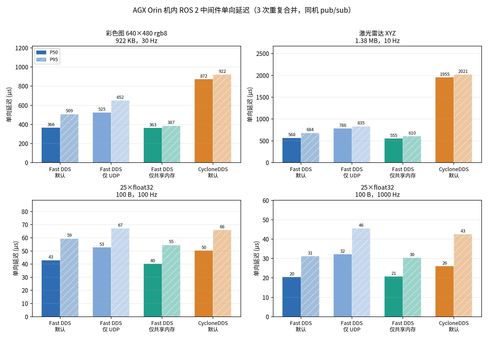

# 6 ROS 2 中间件机内延迟对比

Fast DDS（默认 / 仅 SHM / 仅 UDP）与 CycloneDDS · AGX Orin · Humble

在 NVIDIA Jetson AGX Orin 机内，用同一份 C++ `rclcpp` 发布/订阅代码，比较 ROS 2 Humble 中可用的中间件与 Fast DDS 传输路径在**相机图像、激光雷达点云、25 维关节数组**上的单向延迟：

- **Fast DDS 默认**（UDPv4 + 共享内存传输，`rmw_fastrtps_cpp`）
- **Fast DDS 仅共享内存**（`FASTDDS_BUILTIN_TRANSPORTS=SHM`）
- **Fast DDS 仅 UDP**（`FASTDDS_BUILTIN_TRANSPORTS=UDPv4`）
- **CycloneDDS 默认**（`rmw_cyclonedds_cpp`）

并单独验证了 **Fast DDS Data-sharing delivery**（零拷贝）能否用于 ROS 2 消息。

## 概要

| 数据 | Fast DDS 默认 P50 | 仅 UDP P50 | CycloneDDS P50 | 结论 |
| --- | ---: | ---: | ---: | --- |
| 彩色图 922 KB，30 Hz | **366.4 µs** | 524.8 µs（+43%） | 871.8 µs（+138%） | 默认已走共享内存 |
| 激光雷达 1.38 MB，10 Hz | **568.1 µs** | 786.1 µs（+38%） | 1,955.2 µs（+244%） | 同上 |
| 25×float32 100 B，100 Hz | 42.9 µs | 52.6 µs | 50.2 µs | 差异接近噪声 |
| 25×float32 100 B，1000 Hz | **20.4 µs** | 32.2 µs（+57%） | 26.1 µs（+28%） | 小包也能看出 SHM 优势 |

三条主要结论：

1. **Fast DDS 默认配置在同机对大消息已经走共享内存（SHM transport）**。922 KB 图像和 1.38 MB 点云的 P50 分别为 366 µs、568 µs；把传输强制改成 UDP 后变成 525 µs、786 µs。仅 SHM 与默认的结果相同（363 µs、555 µs），说明默认路径本来就是 SHM。
2. **Fast DDS Data-sharing（真正的零拷贝）在 Humble + `rmw_fastrtps` 下无法启用**：`rmw_fastrtps` 在加载 XML 之后会无条件执行 `data_sharing().off()`；用 `RMW_FASTRTPS_USE_QOS_FROM_XML=1` 绕过时，通配 profile 会让 `/rosout`（无界 `Log` 类型）在节点初始化时报 `Data sharing cannot be used with unbounded data types`，限定到话题又会在数据路径抛 `NotEnoughMemoryException`。标准 `Image`/`PointCloud2`/`Float32MultiArray` 本身是无界 sequence，按设计就不满足 bounded 条件。可用的"共享内存"形态是 SHM transport（有一次拷贝），不是 Data-sharing。
3. **CycloneDDS 在大载荷上明显更慢，差距主要来自接收侧的分片/重组**：其发布调用本身只比 Fast DDS 慢约 2 倍（663 µs vs 322 µs，图像），但端到端延迟多出 208 µs（图像）和约 1,000 µs（点云）。用 `/proc/net/snmp` 统计 UDP 数据报：同样一帧 1.38 MB 点云，Fast DDS 约 31 个数据报、CycloneDDS 约 126 个（图像为 23 vs 85），接收侧开销与这个比例同向。

> 关于命名：用户提到的 `contextdds` 按 **CycloneDDS** 理解（Orin 上已安装 `ros-humble-rmw-cyclonedds-cpp 1.3.5`）。如果指的是 RTI Connext DDS，则 Humble/arm64 没有官方 apt 二进制、机器上也没有安装，本次未测。

## 1. 实验环境

| 项目 | 配置 |
| --- | --- |
| 硬件 | NVIDIA Jetson AGX Orin Developer Kit，8×Cortex-A78AE，29 GiB 内存 |
| 系统 | Ubuntu 22.04.5 LTS，内核 5.15.148-tegra |
| ROS 2 | Humble |
| Fast DDS | 2.6.12（`rmw_fastrtps_cpp` 6.2.10） |
| CycloneDDS | 0.10.5（`rmw_cyclonedds_cpp` 1.3.5） |
| CPU 频率 | `jetson_clocks` + `performance` governor，8 核均锁 2.1888 GHz |
| 共享内存 | `/dev/shm` 15 GiB |
| 网络 | 仅本机回环；每轮用独立 `ROS_DOMAIN_ID`，无其他 ROS 进程 |

Orin 上还安装了 `rmw_zenoh_cpp 0.1.11`、iceoryx 2.0.5，但 Zenoh 需要额外 router、iceoryx 不属于 ROS 2 RMW，本次未纳入；iceoryx2 / eCAL / DAVOS_SIM 的对比见 `4 五种中间件延迟对比.md`。

## 2. 测量方法

- **两个独立进程**：发布者与订阅者都是 C++ `rclcpp` 节点（`mw_bench`），避免 Python 序列化/GIL 开销掩盖中间件差异。
- **延迟口径**：订阅回调入口的 `CLOCK_REALTIME` 减去 `rmw_message_info_t.source_timestamp`。`source_timestamp` 由 RMW 在 `DataWriter::write()` 入口打点，因此一条样本包含：CDR 序列化 → 传输或共享内存拷贝 → 反序列化 → 回调调度。同机同钟，无需时钟校正。
- **QoS**：`best_effort`、`keep_last(1)`、`volatile`，与传感器话题的常用配置一致。
- **负载**：按真实传感器流的尺寸合成，内容不影响延迟：

| 流 | 消息类型 | 载荷 | 速率 | 对应 |
| --- | --- | ---: | ---: | --- |
| image | `sensor_msgs/Image` | 640×480 rgb8 = 921,600 B | 30 Hz | RealSense D455 彩色 |
| cloud | `sensor_msgs/PointCloud2` | 43,000 点 × 32 B = 1,376,000 B | 10 Hz | RSLiDAR Airy XYZ |
| joints100 | `std_msgs/Float32MultiArray` | 25×float32 = 100 B | 100 Hz | 25 个电机位置 |
| joints1k | 同上 | 100 B | 1000 Hz | 25 个电机位置 |
| joint25 | `mw_bench/Joint25`（`float32[25]` 定长） | 108 B | — | Data-sharing 探测 |

- **采样**：每轮先发布 2 s 预热（丢弃），再记录 10 s；每个配置重复 3 次，按配置轮转顺序运行以摊平热漂移；统计时把 3 次的样本合并后取分位数。
- **CPU 绑定**：发布者绑 CPU 4–5，订阅者绑 CPU 6–7；测量期间 8 核均为 performance governor。
- **发布调用耗时**：在 `publish()` 前后各取一次时间（`t1 − t0`），包含序列化与传输写入，用来区分"发送侧成本"和"接收侧成本"。
- **清洁**：每轮前删除 `/dev/shm/fastrtps_*` 残留，结束后等待两个进程退出。

## 3. 被测配置

| 名称 | RMW | 关键环境变量 | 含义 |
| --- | --- | --- | --- |
| `fastdds` | `rmw_fastrtps_cpp` | 无 | ROS 2 Humble 默认：UDPv4 + SHM（512 KB 段） |
| `fastdds-shm` | `rmw_fastrtps_cpp` | `FASTDDS_BUILTIN_TRANSPORTS=SHM` | 只用共享内存传输 |
| `fastdds-udp` | `rmw_fastrtps_cpp` | `FASTDDS_BUILTIN_TRANSPORTS=UDPv4` | 只用 UDP，隔离 SHM 的贡献 |
| `cyclonedds` | `rmw_cyclonedds_cpp` | 无 | CycloneDDS 默认（UDP 回环） |
| `fastdds-ds` | `rmw_fastrtps_cpp` | XML `data_sharing=ON` + `RMW_FASTRTPS_USE_QOS_FROM_XML=1` | Data-sharing 探测，预期失败 |

另外做过两组一次性探测：`fastdds-shm16`（XML 把 SHM 段调到 16 MB）和 `cyclonedds-lo`（绑定 `lo` 网卡），用于解释机制，不进入主表。

## 4. 结果

### 4.1 大载荷：彩色图与点云

3 次重复、共 900 / 300 帧合并：

| 数据 | 配置 | 接收/发送 | 丢帧率 | 平均 | P50 | P95 | P99 | 最大 |
| --- | --- | ---: | ---: | ---: | ---: | ---: | ---: | ---: |
| 彩色图 922 KB，30 Hz | Fast DDS 默认 | 893 / 900 | 0.8% | 377.3 | **366.4** | 508.6 | 572.0 | 660.3 |
| 彩色图 922 KB，30 Hz | Fast DDS 仅 SHM | 894 / 900 | 0.7% | 366.8 | **363.0** | 386.8 | 443.7 | 1712.4 |
| 彩色图 922 KB，30 Hz | Fast DDS 仅 UDP | 897 / 900 | 0.3% | 547.9 | 524.8 | 651.7 | 768.2 | 1959.3 |
| 彩色图 922 KB，30 Hz | CycloneDDS 默认 | 897 / 900 | 0.3% | 875.7 | 871.8 | 922.1 | 961.8 | 2166.8 |
| 激光雷达 1.38 MB，10 Hz | Fast DDS 默认 | 294 / 300 | 2.0% | 578.2 | **568.1** | 683.6 | 753.2 | 783.0 |
| 激光雷达 1.38 MB，10 Hz | Fast DDS 仅 SHM | 294 / 300 | 2.0% | 559.6 | **555.0** | 609.9 | 636.6 | 668.3 |
| 激光雷达 1.38 MB，10 Hz | Fast DDS 仅 UDP | 297 / 300 | 1.0% | 791.8 | 786.1 | 835.3 | 882.1 | 1062.6 |
| 激光雷达 1.38 MB，10 Hz | CycloneDDS 默认 | 297 / 300 | 1.0% | 1929.8 | 1955.2 | 2020.6 | 2072.2 | 2154.6 |

### 4.2 小载荷：25×float32

| 数据 | 配置 | 接收/发送 | 丢帧率 | 平均 | P50 | P95 | P99 | 最大 |
| --- | --- | ---: | ---: | ---: | ---: | ---: | ---: | ---: |
| 100 B，100 Hz | Fast DDS 默认 | 2,998 / 3,000 | 0.07% | 46.3 | 42.9 | 59.5 | 160.0 | 1074.3 |
| 100 B，100 Hz | Fast DDS 仅 SHM | 2,997 / 3,000 | 0.10% | 40.6 | 40.3 | 54.6 | 67.8 | 1462.1 |
| 100 B，100 Hz | Fast DDS 仅 UDP | 3,000 / 3,000 | 0.00% | 54.8 | 52.6 | 67.2 | 142.8 | 2086.0 |
| 100 B，100 Hz | CycloneDDS 默认 | 2,999 / 3,000 | 0.03% | 49.0 | 50.2 | 65.9 | 74.9 | 132.7 |
| 100 B，1000 Hz | Fast DDS 默认 | 29,997 / 30,000 | 0.01% | 22.5 | **20.4** | 31.2 | 59.5 | 581.5 |
| 100 B，1000 Hz | Fast DDS 仅 SHM | 29,997 / 30,000 | 0.01% | 22.2 | **20.8** | 30.4 | 37.5 | 84.8 |
| 100 B，1000 Hz | Fast DDS 仅 UDP | 29,994 / 30,000 | 0.02% | 34.3 | 32.2 | 45.6 | 67.6 | 725.2 |
| 100 B，1000 Hz | CycloneDDS 默认 | 29,983 / 29,997 | 0.05% | 29.8 | 26.1 | 42.6 | 81.2 | 2114.9 |



### 4.3 相对 Fast DDS 默认的变化

| 数据 | 仅 UDP P50 / P95 | 仅 SHM P50 / P95 | CycloneDDS P50 / P95 |
| --- | ---: | ---: | ---: |
| 彩色图 922 KB | +43.2% / +28.1% | −0.9% / −24.0% | +137.9% / +81.3% |
| 激光雷达 1.38 MB | +38.4% / +22.2% | −2.3% / −10.8% | +244.2% / +195.6% |
| 100 B，100 Hz | +22.6% / +13.0% | −6.2% / −8.2% | +17.0% / +10.9% |
| 100 B，1000 Hz | +57.4% / +46.0% | +1.6% / −2.7% | +27.5% / +36.4% |

小载荷 100 Hz 这一行要谨慎看：同一配置三次运行的 P50 本身就在 35–49 µs（Fast DDS 默认）之间波动，±10 µs 的差异已接近运行间抖动。

### 4.4 发布调用耗时（序列化 + 传输写入）

| 数据 | Fast DDS 默认 | Fast DDS 仅 SHM | Fast DDS 仅 UDP | CycloneDDS |
| --- | ---: | ---: | ---: | ---: |
| 彩色图 922 KB | 321.7 µs | 309.6 µs | 484.8 µs | 663.4 µs |
| 激光雷达 1.38 MB | 519.2 µs | 504.4 µs | 729.6 µs | 955.9 µs |
| 100 B，100 Hz | 16.3 µs | 15.8 µs | 21.3 µs | 29.0 µs |
| 100 B，1000 Hz | 6.0 µs | 5.7 µs | 19.8 µs | 13.5 µs |

这张表说明了钱花在哪里：922 KB 图像的端到端 366 µs 里有 322 µs 花在 `publish()` 内（序列化 + 写入 SHM），接收侧只增加约 45 µs。CycloneDDS 的 `publish()` 本身就更贵（663 µs），但真正拉开差距的是接收侧：图像多出约 208 µs、点云多出约 1,000 µs。

## 5. Fast DDS Data-sharing 在 Humble 上不可用

### 5.1 三次探测的结果

1. **默认 profile + `data_sharing=ON`**：节点初始化阶段就失败。默认 profile 会命中**所有** DataWriter，包括 `rcl_node_init` 为 `/rosout` 创建的 `rcl_interfaces/msg/Log`（含无界 string）：

   ```text
   [DATA_WRITER Error] Data sharing cannot be used with unbounded data types
     -> Function check_datasharing_compatible
   create_publisher() could not create data writer
   ```

2. **只给 `/xbench/joint25` 配 `ON`，并设置 `RMW_FASTRTPS_USE_QOS_FROM_XML=1`**：端点能创建，但一发布就抛 `eprosima::fastcdr::exception::NotEnoughMemoryException`，订阅端也一样。把 XML 换成**空的**（根本不含 data_sharing）仍然复现——说明这个异常来自 `RMW_FASTRTPS_USE_QOS_FROM_XML` 这条 QoS 覆盖路径，而不是 data_sharing 本身。

3. **只设 `FASTRTPS_DEFAULT_PROFILES_FILE`、不设 `RMW_FASTRTPS_USE_QOS_FROM_XML`**：运行正常，但 data_sharing 完全没有生效——因为 rmw 在加载 XML 之后又把它关掉了（见 5.2）。

### 5.2 直接原因：rmw_fastrtps 主动关闭了 Data-sharing

`rmw_fastrtps_cpp` 6.2.10 的 `publisher.cpp` 在读取 topic 对应的 XML profile 之后，紧接着执行：

```cpp
publisher->get_datawriter_qos_from_profile(topic_name, writer_qos);

if (!participant_info->leave_middleware_default_qos) {
  writer_qos.publish_mode().kind = ...;
  writer_qos.endpoint().history_memory_policy =
    eprosima::fastrtps::rtps::PREALLOCATED_WITH_REALLOC_MEMORY_MODE;
  writer_qos.data_sharing().off();   // <-- 无条件关闭
}
```

订阅端 `subscription.cpp` 同样有 `reader_qos.data_sharing().off();`。而 `leave_middleware_default_qos` 只由环境变量 `RMW_FASTRTPS_USE_QOS_FROM_XML=1` 置位。因此：

- **默认情况下，XML 里的 `data_sharing` 写什么都会被改回 OFF**，连 `AUTO` 都不会被尝试。这不是"XML 没配对"，而是 rmw 代码里写死的策略。
- 一旦设置 `RMW_FASTRTPS_USE_QOS_FROM_XML=1`，rmw 同时不再强制 `PREALLOCATED_WITH_REALLOC` 和同步发布，Fast DDS 的默认值接管。于是出现 5.1 的两种失败：通配 profile 命中 `/rosout`；限定话题则撞上 plain 类型的样本/缓冲区尺寸问题（`NotEnoughMemoryException`）。

### 5.3 类型层面的硬约束

即使绕过 rmw 的开关，Data-sharing 还要求 `TopicDataType::is_bounded() == true`（见 [Data-sharing delivery 文档](https://fast-dds.docs.eprosima.com/en/v2.6.12/fastdds/transport/datasharing.html) 的 Constraints）。`rmw_fastrtps` 确实实现了这个查询（`max_size_bound_` 来自 rosidl 生成的 `max_serialized_size(bounds_info)`），所以定长数组消息会被判为 bounded；但：

- `sensor_msgs/Image`、`PointCloud2`、`std_msgs/Float32MultiArray` 的 `data` 都是无界 `sequence`，**结构上就是 unbounded**，改元素个数没有用；
- 要让相机/点云变成 bounded，必须改消息定义（如 `sequence<uint8, 1048576>` 或定长数组），并让 typesupport 正确上报；
- 对 bounded 的 plain 类型，本套二进制仍会在 data-sharing 数据路径上抛 `NotEnoughMemoryException`（5.1 第 2 条），所以"改成定长消息"也不足以让它工作。

### 5.4 结论

在 Humble + 二进制 `rmw_fastrtps_cpp` 下，Data-sharing 不是"参数没调对"，而是：

1. **默认被 rmw 显式关闭**（`data_sharing().off()`）；
2. **打开它的开关同时会破坏内存策略**，导致 `/rosout` 或 plain 类型在初始化/收发时崩溃；
3. **相机、雷达、关节数组这些标准消息类型本身就是 unbounded**，按设计就不满足条件。

可用的共享内存路径仍然是 **SHM transport**（默认开启、有一次拷贝），本报告测得 922 KB 图像 P50 363–366 µs、1.38 MB 点云 555–568 µs。要真正的零拷贝，需要改 `rmw_fastrtps`/typesupport（去掉 `data_sharing().off()`，并让 bounded 信息与内存策略正确配合），或换用 iceoryx2 / DAVOS_SIM 等独立传输——这属于源码级改造，不是配置项。

## 6. 讨论

### 6.1 默认配置确实走了共享内存

三条独立证据：

1. **延迟**：默认与"仅 SHM"几乎相同（图像 366.4 vs 363.0 µs，点云 568.1 vs 555.0 µs），而"仅 UDP"明显更慢（524.8 / 786.1 µs）。
2. **`/dev/shm` 文件**：默认运行时每个 participant 有一个 549,408 B 的段（512 KiB + 元数据）；XML 设 16 MB 后变成 16,802,336 B。
3. **UDP socket 数**：默认运行时进程持有 12 个 UDP socket（发现与 UDP 传输），强制 SHM 后为 0。

把 SHM 段从 512 KiB 调到 16 MiB 并不改变延迟（单次探测 367 µs vs 369 µs）。原因是 RTPS 会按分片发送，922 KB 样本本来就会被拆成多个分片放进 512 KiB 段，段大小不是瓶颈；**默认配置不需要为"共享内存"做任何 XML 调参**。

### 6.2 CycloneDDS 慢在接收侧

CycloneDDS 的 `publish()` 耗时约为 Fast DDS 的 2 倍（图像 663 vs 322 µs），但端到端差距更大（872 vs 366 µs），说明接收侧还有约 208 µs 的额外成本；点云更明显，接收侧多出约 1,000 µs。

对 UDP 数据报计数（`/proc/net/snmp` 的 `UdpInDatagrams` 增量 ÷ 帧数，5 s 探测）给出了直接解释：

| 数据 | Fast DDS 仅 UDP | CycloneDDS 默认 |
| --- | ---: | ---: |
| 图像 922 KB | 约 22.8 个数据报/帧 | 约 85.2 个数据报/帧 |
| 点云 1.38 MB | 约 31.2 个数据报/帧 | 约 126.1 个数据报/帧 |

CycloneDDS 把同样一帧拆成约 3.5–4 倍的数据报，接收侧重组与逐包处理的次数随之增加；点云的绝对开销更大，说明其重组/缓冲路径在更大的样本上更吃亏。我们尝试把 CycloneDDS 的 `FragmentSize` 调到 60 KB，但在 loopback 上 `ddsi_udp_conn_write` 返回 `-58`、订阅端收不到数据，未能得到可用的调优结果；因此表中是**默认配置**的 CycloneDDS，未做进一步调参。把 CycloneDDS 绑定到 `lo` 网卡只把图像 P50 从 879 µs 降到 856 µs，说明瓶颈不在网卡选择。

### 6.3 小数据的反直觉现象：100 Hz 比 1000 Hz 更慢

同样 100 B，Fast DDS 默认在 100 Hz 下 P50 为 42.9 µs，在 1000 Hz 下只有 20.4 µs。这不是中间件在低频时更慢，而是两端线程都从"睡眠—唤醒"切换到"常热"：100 Hz 时 `publish()` 本身从 1 kHz 的 6.0 µs 涨到 16.3 µs（发布线程冷启动），接收侧的回调唤醒也要多付约 12 µs；1 kHz 时消息每 1 ms 到达，收发线程几乎一直醒着，唤醒成本被摊薄。Fast DDS 仅 UDP 也有同样现象（52.6 → 32.2 µs）。

这带来一个方法论上的提醒：**在 100 Hz 的 100 B 测试里，中间件之间的差异（40–53 µs）小于"唤醒 vs 常热"带来的差异（约 20 µs）**。选型时应以目标控制频率实测，不要把低频小包结果外推到 1 kHz。

### 6.4 与既有结果对照

此前 `4 五种中间件延迟对比.md` 里 ROS 2 彩色图是 0.72 ms、点云 1.02 ms（读者数 1）。本报告同样的 Orin、同样的默认 RMW，得到 0.366 / 0.568 ms，约为其一半。差异来自测量口径而不是机器：该报告的 reader 是独立进程，计时从"发送前"开始、到完成私有 OpenCV / PCL 拷贝为止，还包含 Python 与 CSV 写盘；本报告是 C++ 节点、默认 SHM 路径、从 `write()` 入口计时，reader 直接消费反序列化后的消息。

这也说明为什么"ROS 2 比专用共享内存慢 3–4 倍"不能直接引用：在 4 号报告的同一口径下，ROS 2 彩色图 0.72 ms、DAVOS_SIM 0.22 ms，差距约 3 倍；但把基线换成本报告的 C++ + `write()` 口径后，Fast DDS 的 0.366 ms 与该报告的 DAVOS 数字已不在同一套计时边界上，不能再相减。**"换中间件能降多少"高度依赖于基线是怎么测的**，这是本项目一开始就强调的"先测量、再优化"的又一个例子。

## 7. 工程建议

1. **大载荷（图像/点云）先确认 SHM 生效，而不是先换中间件。** `ros2 run` 默认就带 `rmw_fastrtps_cpp`；在 Orin 上 922 KB 图像 366 µs、1.38 MB 点云 568 µs。若发现延迟在 0.5–0.9 ms，先检查是否被 `FASTDDS_BUILTIN_TRANSPORTS=UDPv4`、容器 `/dev/shm` 过小或 `RMW_IMPLEMENTATION` 覆盖成了别的实现。
2. **不要为了"共享内存"去调 SHM 段大小。** 512 KiB 默认段配合 RTPS 分片已能承载 1.38 MB 样本；把段调到 16 MiB 没有收益，反而增加每个 participant 的常驻共享内存。
3. **Data-sharing 不要写进 Humble 的方案里。** 二进制 `rmw_fastrtps` 默认把它强制关闭，绕过开关会触发 `/rosout` 或 `NotEnoughMemoryException` 问题；标准传感器消息又是 unbounded。若确实需要零拷贝，优先评估 iceoryx2 / DAVOS_SIM 这类独立传输，或升级到对 bounded 类型支持更好的 ROS 2 版本（本报告未验证）。
4. **CycloneDDS 适合作为 DDS 互操作/多厂商备份，不适合直接替换 Orin 上的大载荷路径。** 默认配置下图像慢 2.4 倍、点云慢 3.4 倍；要缩小差距需要调大 RTPS 分片，但在 loopback 上我们的调参尝试未成功，需要进一步验证。
5. **控制环（25 维关节）在 1 kHz 下 Fast DDS 默认 P50 约 20 µs、P99 约 60 µs。** 相对 1 ms 周期余量充足；真正的风险是偶发 0.6–2 ms 的尾延迟（调度/页错误），需要靠 CPU 隔离、实时优先级和 `mlock` 处理，而不是换中间件。

## 8. 局限

- 负载是按真实尺寸合成的常量缓冲区（原 bag 已不在 Orin 上，RealSense 驱动也未安装）；真实相机/雷达的采集与零拷贝发布不在测量范围内。
- 单发布者、单订阅者，没有测多读者扇出；多读者会放大序列化与拷贝成本，结论可能不同。
- 只在 performance governor + CPU 绑定的条件下测；默认 `schedutil` 下绝对延迟会更高、抖动更大。
- CycloneDDS 只测了默认配置；调大分片的尝试失败，未得到"调优后"的数字。
- Data-sharing 的"理论收益"无法在 ROS 2 层测到；若需要该数字，需要单独写原生 Fast DDS 定长类型程序。
- 时间窗口 10 s、每配置 3 次；P99/最大值仍受偶发调度尖峰影响，置信区间有限。
- 仅机内；跨机（Orin ↔ 5060Ti）结果见 `RESULTS_CROSS_MACHINE.md`，两者不可直接比较。

## 9. 复现

压测程序（C++ 发布/订阅节点、`Joint25.msg`、矩阵编排与统计脚本）与原始 CSV 不随本文档目录提供，本文只保留统计结果与逐次运行的 P50（见附录）。复现时按第 2 节的方法重建两条独立进程的 C++ 节点，用 `rmw_message_info_t.source_timestamp` 打点，并固定 QoS、绑核与 governor。

## 附录：逐次运行的 P50（µs）

| 配置 | 流 | 第 1 次 | 第 2 次 | 第 3 次 |
| --- | --- | ---: | ---: | ---: |
| Fast DDS 默认 | image | 363.8 | 365.2 | 370.4 |
| Fast DDS 默认 | cloud | 563.4 | 553.1 | 593.6 |
| Fast DDS 默认 | joints100 | 35.1 | 47.3 | 49.4 |
| Fast DDS 默认 | joints1k | 20.7 | 19.8 | 21.1 |
| Fast DDS 仅 SHM | image | 367.7 | 362.3 | 360.8 |
| Fast DDS 仅 SHM | cloud | 574.5 | 541.5 | 553.0 |
| Fast DDS 仅 SHM | joints100 | 30.6 | 42.8 | 42.5 |
| Fast DDS 仅 SHM | joints1k | 21.0 | 20.2 | 21.4 |
| Fast DDS 仅 UDP | image | 511.9 | 510.8 | 591.8 |
| Fast DDS 仅 UDP | cloud | 784.0 | 783.5 | 793.1 |
| Fast DDS 仅 UDP | joints100 | 45.3 | 60.3 | 47.9 |
| Fast DDS 仅 UDP | joints1k | 31.7 | 34.5 | 30.9 |
| CycloneDDS | image | 883.9 | 872.9 | 855.6 |
| CycloneDDS | cloud | 1893.2 | 1954.9 | 1988.1 |
| CycloneDDS | joints100 | 37.6 | 57.0 | 52.1 |
| CycloneDDS | joints1k | 28.5 | 25.2 | 25.4 |
